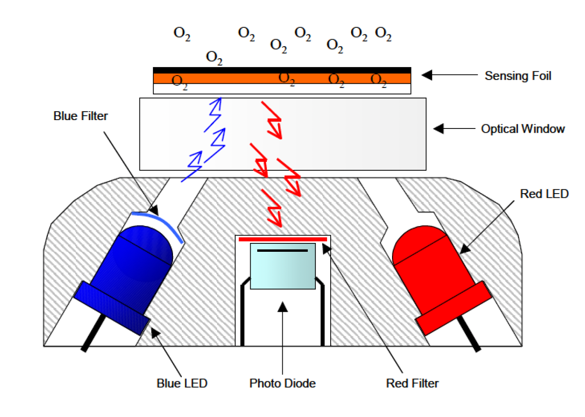
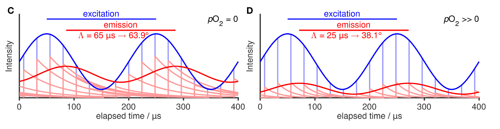
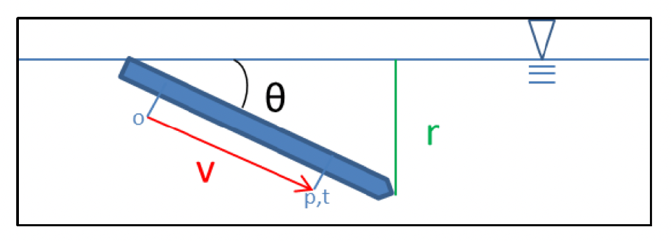

# Oxygen Processing: Aanderaa Optodes

***

# Overview

Dissolved oxygen in seawater gives us information about ocean ventilation, primary productivity, and remineralisation of organic matter. It is therefore considered a key variable in understanding the marine carbon cycle, the biological carbon pump, and evolution of water masses. Oxygen sensors have been integrated on a range of autonomous platforms, such as floats, gliders, and ALRs. Pelagos-py implements an oxygen processing workflow, including calculations that convert raw sensor signals into oxygen concentrations, corrections, quality control, and standardised unit conversions. The workflow presented here is for Aanderaa oxygen optodes only, and has been designed according to best practice protocols (Bittig et al., 2016) and BGC-Argo protocols (Thierry et al., 2025a) that have been adapted where necessary to support a wide range of autonomous observing platforms and their unique capabilities. Default processing parameters are provided as starting points, but should be critically assessed by the user. This documentation is intended to guide these decisions. 

*How does an optode measure dissolved oxygen?*

Dissolved oxygen is measured by optodes based on the principle of luminescence quenching by oxygen molecules. The optode has a sensing foil that is permeable to oxygen, allowing it to diffusion across it. The foil contains luminophores that are excited by short pulses of blue light. When the luminophores relax to their ground state, they release energy in the form of light, i.e., luminescence. When oxygen molecules collide with the luminophores, a part of the released energy is transferred to the oxygen molecule, thereby quenching the luminescence of the luminophores. The amount by which the luminescence is quenched, i.e. the luminescence intensity, can therefore be translated into dissolved oxygen concentration. 



```figure} figures/optode_diagram_Aanderaa2007.png
:alt: Schematic illustration of the oxygen optode (Aanderaa, 2007)
:width: 70%

**Placeholder.**  
```

However, since light intensity is affected by source intensity, scattering, and other variables, it is prone to biases. Instead, a single-frequency phase shift technique is used which relies on the exponential decay of luminescence with time. Excitation intensity is modulated at a constant frequency, producing an emission that can be described as a *phase*. When oxygen molecules quench the luminenscence pulses, the resulting phase is *shifted*. It is this *phase shift* that is used as the measurement of dissolved oxygen. More detailed information can be found in Bittig et al. (2018). 



```figure} figures/diagram_phase_shift_Bittig2018.png
:alt: Schematic illustration of the optode phase shift (Bittig et al., 2018)
:width: 90%

**Placeholder.**  
```

The integration of oxygen sensors onto autonomous platforms has greatly increased the spatial and temporal range on which oxygen variability can be studied and understood. However, the data output of the sensor requires rigorous QC, various corrections, calibrations, and processing by the user. The processing steps may vary depending on the optode type and available calibration data. Differing nomenclature for the same variables outputted by different sensors have been standardised in the OG format, allowing pelagos-py to streamline processing steps as much as possible. Table 1 in the section on <i>Optode Variables</i> summarises how the standardisation of the optode variable names and how they are referred to in pelagos-py. 

The workflow for processing dissolved oxygen measurements consists of the following steps: 

1. **Uncalibrated phase shift** - calculates the uncalibrated phase shift by subtracting the red phase shift from the blue phase shift. If the red phase shift is not included in the dataset or is equal to zero, then the uncalibrated phase shift is simply the blue phase shift.
   
3. **Geometric lag correction** - applies a geometric lag correction that aligns the optode measurements to the CTD measurements as the autonomous platform descends/ascends in the water column. The CTD and optode may be mounted at different locations on different parts of the platform, which means the CTD and optode encounter the same parcel of water at different times. This time delay can lead to offsets in processed oxygen data, especially in strong temperature and salinity gradients. CTD and optode measurements are aligned to correct for this offset.

4. **Pressure correction on phase shift** - applies a pressure correction on the uncalibrated phase shift to correct for the effect of pressure on the luminescence lifetime of the luminophores in the foil. 

5. **Calibrated phase shift** - converts the uncalibrated phase shift into the calibrated phase shift using calibration coefficients provided by the manufacturer. This convertion includes a temperature compensation.

6. **Molar oxygen concentration** - converts the calibrated phase shift into molar oxygen concentration using one of several given methods. Choice of method depends on sensor type and availability of manufacturer coefficients. The resulting molar oxygen concentration is representative of dissolved oxygen concentration in freshwater, i.e., for salinity = 0.

7. **Salinity correction** - applies a salinity correction to the molar oxygen concentration, resulting in a molar oxygen concentration that is representative of the salinity of the measured water parcel.

8. **Pressure correction on molar oxygen concentration** - applies a pressure correction on the molar oxygen concentration to account for the effect of pressure on quenching and on membrane O$_2$ equilibrium level. 

10. **Response correction** - applies a correction to account for the optode response time. 

11. **Dissolved oxygen content** - converts molar oxygen concentration ($\mu$mol L$^{-1}$) to oxygen content ($\mu$mol kg$^{-1}$)

12. **Global range check** - applies a global range check on the oxygen content.

13. **Regional range check** - applies a regional range check on the oxygen content.

14. **In-air calibration** - *not yet implemented*

15. **Two-point calibration** - *not yet implemented* 


# Input Data

The processing requires measurements from both the oxygen optode, the CTD, and several optional glider variables.


### Optode variables

- `TIME` — measurement time
- `BPHASE_DOXY` - phase shift measurement due to blue light excitation [$^{\circ}$]
- `RPHASE_DOXY` - phase shift measurement due to red light excitation (might not exist in dataset, in which case `RPHASE_DOXY` = 0) [$^{\circ}$]
- `CAL_PHASE_DOXY` — calibrated optode phase measurement [$\mu$s] (not required if `BPHASE_DOXY` is available)
- `MOLAR_DOXY` - dissolved oxygen concentration [$\mu$mol L$^{-1}$] | uncorrected for pressure and salinity if outputted directly by the sensor 
- `TEMP_DOXY` — optode temperature [$^{\circ}$C]
- Optode calibration coefficients from the manufacturer calibration sheet

Different optodes give output of the same variables using different nomenclature. These have been standardised in OG format. The table below: 

| Optode | Blue phase shift| Red phase shift | Uncalibrated phase shift | Calibrated phase shift | Molar oxygen concentration | 
| -------------| :-------------: |:------------:| :-------------:|:-------------:|:-------------:|
| Aanderaa 3930, 3835, 3975, 4130, 4175, 3830      | BPHASE | RPHASE |              | DPHASE | MOLAR_DOXY | 
| Aanderaa 4330, 4831, 48351     | C1PHASE |  C2PHASE| TPHASE | CALPHASE | MOLAR_DOXY
| **OG / pelagos-py** | **BPHASE_DOXY** | **PHASE_DOXY** | **UNCAL_PHASE_DOXY** | **CAL_PHASE_DOXY** | **MOLAR_DOXY** |


NRT datasets might different optode variables available compared to recovered datasets. Depending on which optode variables are available, the user can use a different starting point in the optode pipeline. Note that this sometimes means not all corrections can be applied. 
> If `BPHASE_DOXY` is available, start at step 1 of the workflow.
>> If only `UNCAL_PHASE_DOXY` is available, start at step 2 of the workflow.
>>> If only `CAL_PHASE_DOXY` is available, apply step 2 and continue with step 4 of the workflow.
>>>> If only `MOLAR_DOXY` is available, apply step 2 and continue with step 6 of the workflow. 


### CTD variables

- `TIME` — measurement time
- `TEMP` — CTD temperature [$^{\circ}$C]
- `PSAL` — practical salinity [psu]
- `PRES` — pressure [dbar]

### Glider variables

The geometric lag correction can be done using a default time value, or it can be estimated for each cast using the following variables: 

- `vert_gradient` - vertical velocity of the platform, e.g. of the glider (optional) | determined by pelagos-py 
- `pitch` - pitch of the platform, e.g. of the glider (optional)

### Calibration coefficients

Conversions of raw data into meaningful oxygen concentration values requires calibration values that are provided by the manufacturer. 

--- 

# 1. Uncalibrated phase shift 

The uncalibrated phase measurement (`UNCAL_PHASE_DOXY`) is defined and calculated as the difference between the phase from the blue light excitation (`BPHASE_DOXY`) and the red light excitation (`RPHASE_DOXY`). 

$$
UNCAL\_PHASE\_DOXY = BPHASE\_DOXY - RPHASE\_DOXY
$$

The red light excitation is often not used, in which it does not appear in the dataset or is set to zero, and `UNCAL_PHASE_DOXY` = `BPHASE_DOXY`. 

***

# 2. Geometric lag correction

The CTD and oxygen optode may not be physically co-located on the autonomous platform. For example, it is common for the CTD to be integrated nearer the middle or front of a glider, while the optode sits in the rear. The CTD therefore measures a water parcel at a different time than the optode measures the same parcel. We can correct for this time offset by applying a geometric lag correction, which will align the optode data to the CTD data in space and time. 



```{figure} figures/diagram_geometric_alignment_WooGourcuff2023.png
:alt: Schematic illustration of the geometric lag correction (Woo & Gourcuff, 2023)
:width: 70%

**Placeholder.** 
```

If the distance between the sensors is $d$ and the glider's along-track velocity is $v$, the geometric time delay is

$$
\tau_{\mathrm{geom}} = \frac{d}{v}
$$

For a glider, the vertical component of velocity can be approximated by

$$
v = r\sin(\theta)
$$

where:

- $r$ = glider dive rate
- $\theta$ = glider pitch angle

Thus,

$$
\tau_{\mathrm{geom}} = \frac{d}{r\sin(\theta)} $$

For a known constant geometric delay, the optode data are interpolated to the time at which the corresponding water parcel reaches the CTD.

If the optode measurement occurs $\tau_{\mathrm{geom}}$ seconds after the CTD measurement, the optode time corresponding to a CTD observation at time $t$ is

$$
t_{\mathrm{optode}} = t_{\mathrm{CTD}} + \tau_{\mathrm{geom}}
$$

The geometric lag correction can be applied using a default value for the lag (3.945), which is based on a distance between CTD and optode of 90 cm and the ideal conditions for glider travel ($r$ = 0.1 m s$^{-1}$, $\theta$ = 26$^{\circ}$). 

Default configuration: 

```yaml
lag_seconds: 3.945
distance_cm: 90
```

However, the pitch and dive rate can be far from ideal, resulting in values far from average. The user can therefore choose to let the toolbox calculate the mean geometric lag correction for each cast (Woo et al., 2023). This option will still use a default value for the distance between the sensors (90 cm), but this can be changed in the configuration file. The mean pitch and dive rate for each cast are used to calculate $\tau_{\mathrm{geom}}$, which is then passed through a low-pass filter to remove extreme values. The filtered values are then used as a linear time shift to the phase shift data. 

```
Figure placeholder. 
:alt: Example figure of mean geometric lag for each cast (separate for down and up cast), along with a line presenting the low-pass filter. Geometric lag on the y axis, time (or cast) on the y axis. 
:width: 70%

**Placeholder.** 
```


***

# 3. Pressure correction on phase shift

Pressure affects the luminescence lifetime of the luminophores, quenching, and membrane O2 equilibrium level (Bittig et al., 2015a; Bittig et al., 2016). To account for the pressure effect on luminescence lifetime, a hydrostatic pressure correction is applied to the uncalibrated phase shift (following Bittig et al., 2015a; also see Bittig et al., 2018): 

$$UNCAL\_PHASE\_DOXY\_PCORR = UNCAL\_PHASE\_DOXY + Pcoef1 \frac{1}{1000} * PRES$$

`UNCAL_PHASE_DOXY_PCORR` is then the hydrostatic pressure corrected uncalibrated phase shift. 

$Pcoef1$ is a phase offset that depends on the sensing foil and depends on the manufacturer, which are provided in pelagos-py, e.g., 0.1 deg per 1000 dbar for Aanderaa optodes.

Default configuration: 

```yaml
correction_coefficient: 0.1
```

$PRES$ = Pressure in dbar. 

Note that the optode data should have been geometrically adjusted prior to this, and any other step that uses CTD data for processing optode data. 

The pressure effect on quenching and on membrane O$_2$ equilibrium level will be corrected on the oxygen concentration: `MOLAR_DOXY`, which is done after the salinity correction. 

***

# 4. Calibrated phase shift

The raw phase shift (`BPHASE_DOXY`) measured by the optode itself is dependent on temperature. For example, higher temperatures reduce the lifetime of the excited state of the luminophores. High temperatures also increase oxygen diffusivity across the foil, increasing the efficiency of luminescence quenching. The conversion of phase shift to oxygen concentration therefore needs to consider these temperature and oxygen dependencies, which are parameterised using results of elaborate calibration set-ups by the manufacturer that systematically vary oxygen and temperature across a range of values. The calibration coefficients inform mathematical models that are applied to the data. These are described in more detail in the next step that converts the phase shift into oxygen concentration. 

However, each sensor responds differently to varying oxygen and temperature conditions due to differences in the luminophore foil, its thickness, batch, the LED, and electronics. This means that each sensor ideally requires its own set of calibration coefficients. In most new models, this is provided by the manufacturer. However, in some cases, sensors do not have their own individual multi-point calibration. Instead, only a few sensors of the same batch are calibrated for their O$_2$-T-response, the results of which are used as representative of the entire batch. To test how much each individual sensor within the same batch deviates from that batch-level multi-point calibration, manufacturers do a factory test on each sensor, the result of which is four coefficients, named phase coefficients represented on the calibrations sheet as *PhaseCoefs*, that describe how the individual sensors relate to the batch-level calibration in a 4th order polynomial model. This correction needs to be applied in the phase-domain, i.e., before the phase shift is converted into concentration. The result is the calibrated phase (`CAL_PHASE_DOXY`): 

$$ CAL\_PHASE\_DOXY = c_0 + c_1* UNCAL\_PHASE\_DOXY + c_2* UNCAL\_PHASE\_DOXY^2 + c_3* UNCAL\_PHASE\_DOXY^3$$

where $c_0,\ldots,c_3$ are the phase calibration coefficients provided by the manufacturer (shown on the certificate as *PhaseCoef$_0...3}$*) and are specific to the optode model. Phase coefficients c$_2$ and c$_3$ are usually zero, reducing the relationship to a linear function of the uncalibrated phase shift. For newer optode models, this step is often not required, because each sensors has its own multi-point calibration. In these cases, c$_0$ = 0 and c$_1$ = 1. 

Default configuration: 

```yaml
calib_coefficients: [0, 1, 0, 0]
```

> This step is sometimes referred to as the "temperature-compensation" step, which is a term that is carried over historically, but is misleading since this step in the methods does not address the temperature dependence of the foil (this is done in the next step). 

***

# 5. Molar oxygen concentration

As described above, the phase shift measured by the optode itself is dependent on temperature and the impact of temperature also differs across O$_2$ concentrations. The conversion of phase shift to oxygen concentration therefore needs to consider these temperature and oxygen dependencies, which are parameterised using results of elaborate calibration set-ups that systematically vary oxygen and temperature across a range of values and mathematical models. These methods differ slightly depending on the optode type and are therefore described separately below, based on Thierry et al. (2025a) and Bittig et al. (2018). The choice of method depends on the available calibration data provided by the manufacturer. 

## Aanderaa 3830 optodes

Important for these optodes is that the temperature values used in the conversion of phase shift (`CAL_PHASE_DOXY`) to oxygen concentration (`MOLAR_DOXY`) need to come from the CTD's temperature sensor (to which the optode data has been aligned in a previous step), *not* from the optode's temperature sensor. This is because the temperature sesnor of these older optodes had slow response times. 

### Stern-Volmer / SVU 

This method uses the calibration coefficients derived from the multi-point calibration done that characterises the O$_2$-T dependence. The method shown here is only used in early shipments of these sensors: 

$$
MOLAR\_DOXY_{S=0} = (\frac{f_1}{\frac{CAL\_PHASE\_DOXY}{K_0}}-1) K_1
$$

, where K$_0$ and K$_1$ are temperature dependent coefficients calculated using a 3rd degree polynomial with temperature as argument and coefficients provided in the calibration sheet, named *K0Coefs* and *K1Coefs*, respectively. 

f$_1$ and f$_2$ are temperature independent coefficients given in the calibration certification. `MOLAR_DOXY` is in $\mu$mol L$^{-1}$ and represents the oxygen concentration at salinity = 0. 

### Polynomial
The calibrated phase can also be converted into oxygen concentration using 20 coefficients (provided by the manufacturer) that are sensor specific, in a 4$^{th}$ degree polynomial function: 

$$
MOLAR\_DOXY = C_0 + C_1 . CAL\_PHASE\_DOXY + C_2 . CAL\_PHASE\_DOXY^2 + C_3 . CAL\_PHASE\_DOXY^3 + C_4 . CAL\_PHASE\_DOXY^4
$$

, where C$_{0...4}$ are temperature-dependent coefficients (temperature in $^{\circ}$C): 

$$
C_i = C_{i0} + C_{i1} . TEMP + C_{i2} . TEMP^2 + C_{i3} . TEMP^3
$$

### Modefied Stern-Vomer equation for pO$_2$

*This method has not yet been implemented.*


## Aanderaa 4330 optodes

In contrast to the Aanderaa 3830 optodes, the conversion of `CAL_PHASE_DOXY` to `MOLAR_DOXY` for Aanderaa 4330 optodes can use the temperature values of the optode's temperature sensor (`TEMP_DOXY`), as its response time is much better than the older versions. 

### Stern-Volmer - SVU
This method uses the calibration coefficients derived from the multi-point calibration done that characterises the O$_2$-T dependence. 

The temperature-dependent coefficients of this method are

$$ K_{SV} = c_0+c_1T+c_2T^2 $$

and

$$ P_0=c_3+c_4T $$

while the phase-dependent term is

$$ P_c=c_5+c_6 CAL\_PHASE\_DOXY. $$

The freshwater-equivalent oxygen concentration is then

$$ MOLAR\_DOXY_{S=0} = \frac{ P_0/P_c-1 }{ K_{SV} }. $$

Calibration coefficents c$_{0...6}$ are provided in the manufacturer's calibration certificate as *SVUFoilCoefs*. 

A two-point concentration adjustment may subsequently be applied:

$$ MOLAR\_DOXY_{S=0,adj} = MOLAR\_DOXY_{S=0} \cdot \mathrm{ConcCoef1} + \mathrm{ConcCoef0}. $$

The coefficients for this adjustment are given in the calibration certificate as *ConcCoefs*. The two-point adjustment is usually redundant if the multi-point calibration has been done for each individual sensor. However, in some cases like when calibrations have only been done at the batch-level, this correction is another opportunity to correct sensor-specific offsets to reference calibrations. If the coefficients are given by the manufacturer, this correction should be applied. 

`MOLAR_DOXY` is in $\mu$mol L$^{-1}$ and represents the oxygen concentration at salinity = 0.

### Polynomial

The polynomial method for the Aanderaa 4330 series calculates `MOLAR_DOXY` based on oxygen solubility (C$^{\ast}$; cm$^3$ dm$^{-3}$) and air saturation (AirSat; $\%$):

$$
MOLAR\_DOXY = C^{\ast} . 44.614 . \frac{AirSat}{100}
$$

The air saturation of oxygen is dependent on the partial pressure of O$_2$ (pO$_2$), which is determined from `CAL_PHASE_DOXY` using a two-dimensional polynomial: 

$$
pO_2 =  C_0 . T^{m0} . CAL\_PHASE\_DOXY^{n0} + C_1 . T^{m1} . CAL\_PHASE\_DOXY^{m1} + ... + C_{27} . T^{m27} . CAL\_PHASE\_DOXY^{m27}
$$

, where C_{0...13} and C_{14...27} are provided on the calibration certificate as *FoilCoefA$_{0...13}$* and *FoilCoefA$_{0...13}$*, respectively. Temperature exponents m0...27 are shown as *FoilPolyDegT$_{0...27}$* and phase exponents n0...27 as *FoilPolyDegO$_{0...27}$*. 

`MOLAR_DOXY` is in $\mu$mol L$^{-1}$ and represents the oxygen concentration at salinity = 0.

Similarly to the Stern-Volmer method, a two-point concentration adjustment can subsequently be applied if coefficients have been provided by the manufacturer (see above). 


### Modified Stern-Vomer equation for pO$_2$

*This method has not yet been implemented.*

*** 

# 6. Salinity correction

The optode is not dependent on salinity, as it responds to the oxygen partial pressure ($pO{_2}$), which is independent of salinity. However, the O$_2$ concentration it measures is dependent on salinity, as it depends on seawater O$_2$ solubility. The oxygen concentration determined using factory-provided calibration metadata is representative for freshwater, because it does not take this salinity-dependence into account. A correction is therefore necessary, which relates the the molar oxygen concentration for salinity = 0 to the molar oxygen concentration at seawater salinity (Bittig et al., 2016; 2018). The salinity-correction has two components. One is the correction term (S$_{corr}$), which addresses the effect of salinity on O$_2$ solubility. The other component adjusts the water vapour pressure, which depends on salinity as it changes the atmospheric composition and therefore pO$_2$.

The overall salinity correction applied is represented by the following function: 

$$
MOLAR\_DOXY_{S} = \frac{1013.25-p_{\mathrm{H_2O}}(T,S_{preset})}{1013.25-p_{\mathrm{H_2O}}(T,S)} . S_{corr} . MOLAR\_DOXY_{S=0}
$$

where:

- $S$ = practical salinity (`SAL`)
- $T$ = temperature in $^{\circ}$C (`TEMP` from CTD for both Aanderaa 3830 optodes and Aanderaa 4330 optodes)
- $p_{\mathrm{H_2O}}$ = water-vapour partial pressure following Weiss & Price (1980)
- $S_{\mathrm{Corr}}$ = salinity-dependent oxygen-solubility correction

The salinity correction factor (S$_{corr}$) is calculated as

$$S_{\mathrm{Corr}}=\exp\left[(S-S_{\mathrm{ref}})(B_0+B_1T_s+B_2T_s^2+B_3T_s^3)+C_0(S^2-S_{\mathrm{ref}}^2)\right]$$

where

$$T_s=\ln\left(\frac{298.15-T}{273.15+T}\right)$$

and $B_0,\ldots,B_3$ and $C_0$ are the coefficients recommended by the SCOR Working Group 142 (Bittig et al., 2016).

Keep S$_{ref}$ and S$_{preset}$ = 0, as the former should not be used for `MOLAR_DOXY` re-calculated externally to the sensor and the latter needs to be set to 0 to account for the water vapour pressure effect, which Aanderaa neglects. 


***

# 7. Pressure correction on molar oxygen concentration

Hydrostatic pressure affects the oxygen quenching response of the optode.

The pressure correction can be applied to the salinity-corrected oxygen quantity:

$$\mathrm{MOLAR\_DOXY}_{\mathrm{PSAL,PCORR}}=\mathrm{MOLAR\_DOXY}_{\mathrm{PSAL}}\left[1+\left(P_{\mathrm{coef2}}T+P_{\mathrm{coef3}}\right)\frac{PRES}{1000}\right]$$

where:

- $T$ = CTD temperature ($^\circ$C)
- $PRES$ = pressure (dbar)
- $P_{\mathrm{coef2}}$ and $P_{\mathrm{coef3}}$ = pressure-response coefficients

The correction should use the **CTD temperature**.

For optodes where phase has already been corrected for pressure:

$$
P_{\mathrm{coef2}}=0.00022
$$

$$
P_{\mathrm{coef3}}=0.0419
$$

For optodes where phase has not been corrected for pressure:

$$
P_{\mathrm{coef2}}=0.00025
$$

$$
P_{\mathrm{coef3}}=0.0328
$$


***

# 8. Response correction

***

# 9. Dissolved oxygen content
Oxygen concentration may initially be expressed as

$$
c_{\mathrm{O_2}}
\quad
[\mu\mathrm{mol\,L^{-1}}].
$$

For comparison with standard oceanographic oxygen data products, this can be converted to

$$
c_{\mathrm{O_2}}
\quad
[\mu\mathrm{mol\,kg^{-1}}]
$$

using seawater density:

$$
c_{\mathrm{O_2},kg}
=
\frac{
c_{\mathrm{O_2},L}
}{
\rho
}
$$

where $\rho$ is the seawater density in kg L$^{-1}$.

The density should be calculated using practical salinity and referenced to 0 dbar.

***

# 10. Global range check

Values outside physically plausible global ranges should be flagged as bad data.

**Dissolved oxygen**

$$
-5
\leq
DOXY
\leq
600
\quad
[\mu\mathrm{mol\,kg^{-1}}]
$$

Values outside this range are assigned QC flag `4` ("bad data").

### Oxygen temperature

$$
-2.5 \leq TEMP\_DOXY \leq 40.0 \quad [^\circ\mathrm{C}]
$$

Values outside this range are assigned the appropriate bad-data QC flag.

***

# 11. Regional range check

Values outside physically plausible regional ranges should be flagged as bad data.

***

# 12. In-air calibration

***

# 13. Two-point calibration


*** 

# References

- Aanderaa (2007). TD 218 Operating Manual Oxygen Optodes.
- Bittig, H. C. et al. (2015). *Pressure Response of Aanderaa and Sea-Bird Oxygen Optodes*. Journal of Atmospheric and Oceanic Technology.
- Bittig, H. C. et al. (2016). SCOR Working Group 142 recommendations for oxygen quantity conversions.
- Bittig, H. C. et al. (2017). *Oxygen Optode Sensors: Principle, Characterization, Calibration, and Application in the Ocean*. Frontiers in Marine Science.
- Garcia, H. E. & Gordon, L. I. (1992). Oxygen solubility in seawater: better fitting equations.
- Hahn, J. et al. — response-time characterization and correction of oxygen optodes.
- Uchida, H. et al. (2008). Oxygen optode calibration and temperature compensation.